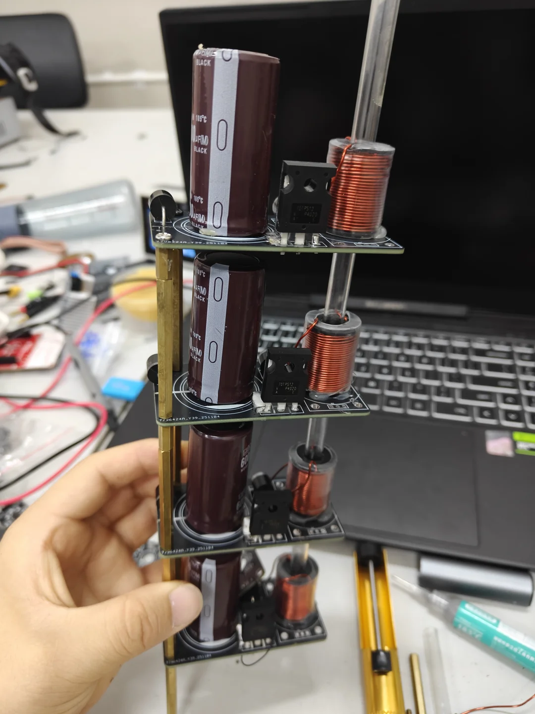
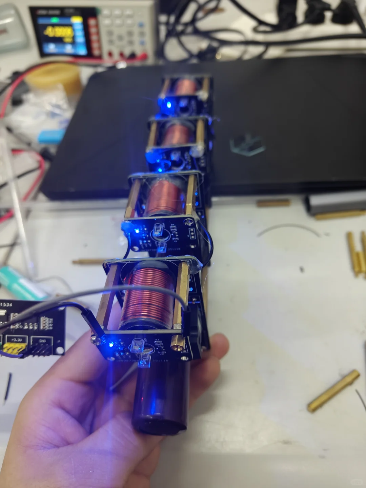

# 做了一个电磁炮

| 项目 | 内容 |
| --- | --- |
| 作者 | 为欢几何（小红书号 5411270979） |
| 发布时间 | 2026-11-26 |
| 类型 | 图文 |
| 点赞 | 0 |
| 收藏 | 0 |
| 评论 | 0 |
| 分享 | 0 |
| IP 属地 | 河南 |
| 小红书原链接 | https://www.xiaohongshu.com/explore/6b0783f20000000026011e9b |

## 配图

## 正文

做了一个电磁炮
光电传感器加大功率晶体管70tp12s和高压蓄电电容。当金属导体再第一级手动触发发射，经过第二级时，触发光电传感器，高电平触发晶体管，导通电容放电，实现多级加速。
