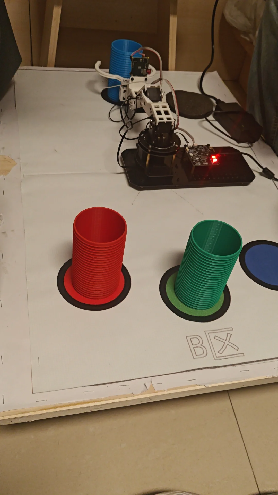

# AIC精英算法大赛备赛调试阶段

| 项目 | 内容 |
| --- | --- |
| 作者 | 为欢几何（小红书号 5411270979） |
| 发布时间 | 2026-11-26 |
| 类型 | 视频 |
| 点赞 | 0 |
| 收藏 | 0 |
| 评论 | 0 |
| 分享 | 0 |
| 小红书原链接 | https://www.xiaohongshu.com/explore/6b0782520000000026011b77 |

## 配图

## 视频

- [视频文件（mp4）](../images/01/video.mp4) · 时长 21 秒

## 正文

AIC精英算法大赛备赛调试阶段
负责机械臂角度位置都调整，纠正位置错误，机械臂控制器的硬件修理。
使用stm32f103rc6进行控制，使用总线舵机，电路稳压使用的是tps5450（5V稳压）+ams1117（3.3V稳压）。期间队友在烧录程序时接错电压烧毁稳压芯片，后期排查电路故障，修理由我负责
