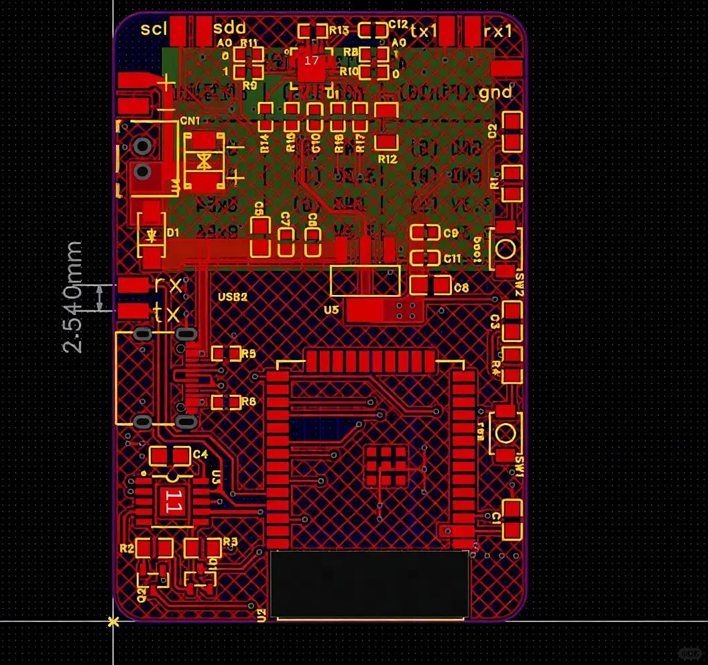
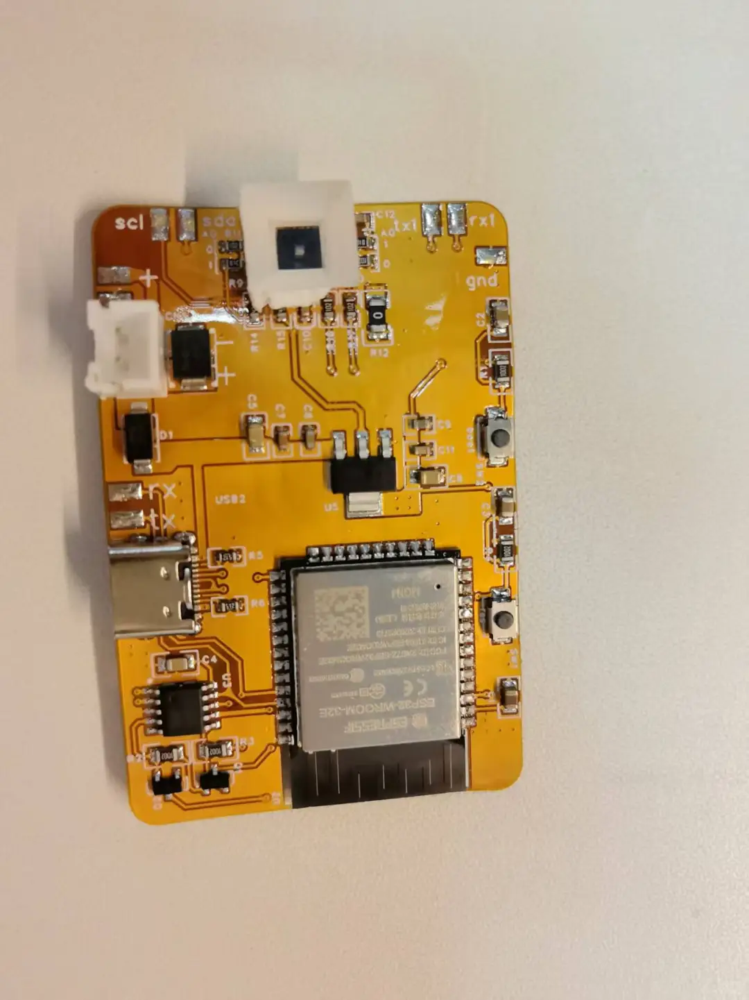
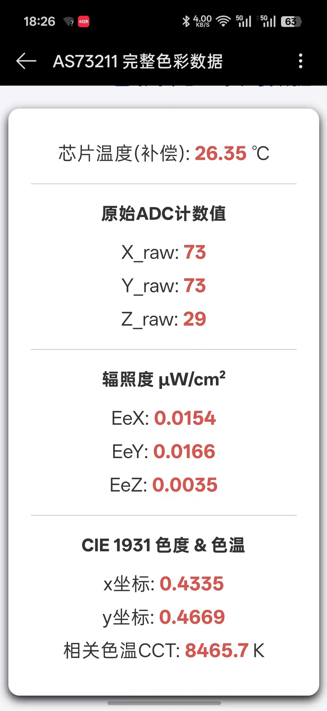
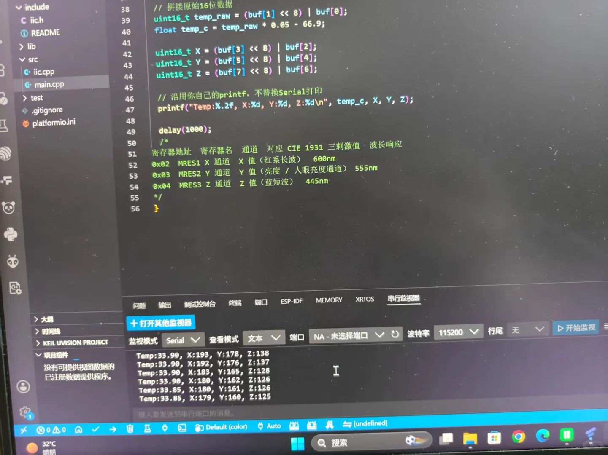

# as7121色温传感器，使用iic通信，国内没有查到相关开发历程，只能对照芯片手册配置寄存器读取芯片数据。使用ESP32芯片，链接上ESP32上的WIFI后输入网址可以进入数据查看页面

| 项目 | 内容 |
| --- | --- |
| 作者 | 为欢几何（小红书号 5411270979） |
| 发布时间 | 2026-11-26 |
| 类型 | 图文 |
| 点赞 | 1 |
| 收藏 | 0 |
| 评论 | 0 |
| 分享 | 0 |
| IP 属地 | 河南 |
| 小红书原链接 | https://www.xiaohongshu.com/explore/6b077e9b000000002b0028db |

## 配图

## 正文

as7121色温传感器，使用iic通信，国内没有查到相关开发历程，只能对照芯片手册配置寄存器读取芯片数据。使用ESP32芯片，链接上ESP32上的WIFI后输入网址可以进入数据查看页面
