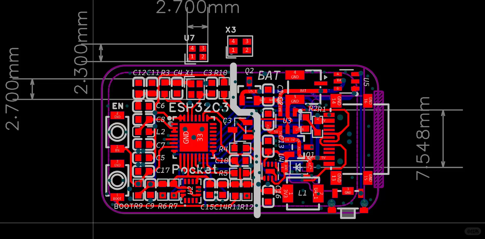

# Esp 32c3挂件的电路图两层板，有陀螺仪（交互作用），电池充电保护，延时按键开关，稳压模块

| 项目 | 内容 |
| --- | --- |
| 作者 | 为欢几何（小红书号 5411270979） |
| 发布时间 | 2026-11-26 |
| 类型 | 图文 |
| 点赞 | 1 |
| 收藏 | 0 |
| 评论 | 0 |
| 分享 | 0 |
| IP 属地 | 河南 |
| 小红书原链接 | https://www.xiaohongshu.com/explore/6b0776b800000000250102b5 |

## 配图

## 正文

Esp 32c3挂件的电路图两层板，有陀螺仪（交互作用），电池充电保护，延时按键开关，稳压模块
