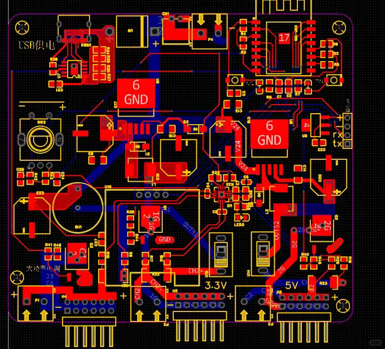
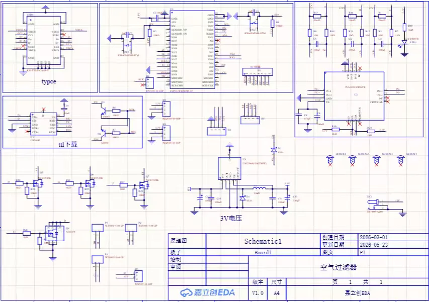
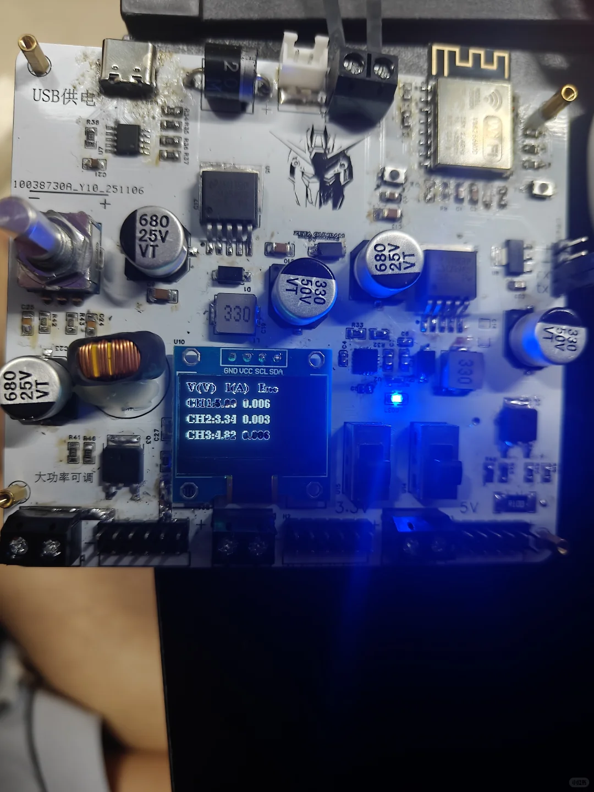

# 联网稳压控制电源

| 项目 | 内容 |
| --- | --- |
| 作者 | 为欢几何（小红书号 5411270979） |
| 发布时间 | 2026-11-03 |
| 类型 | 图文 |
| 点赞 | 0 |
| 收藏 | 0 |
| 评论 | 1 |
| 分享 | 0 |
| IP 属地 | 河南 |
| 小红书原链接 | https://www.xiaohongshu.com/explore/6ae9fd57000000000e036bdc |

## 配图

## 正文

基于 ESP‑12F 设计多路可调稳压电源监测控制系统，采用 LM2596 实现 5 V / 3.3 V / 12 V 多路稳压输出；使用 INA3221 采集三路通道的电压、电流信息，并在 OLED 屏幕实时显示。系统可对 12 V 通路输出 12 位分辨率 PWM，通过电位器调节占空比；配合 P+MOS 管实现电源通路控制，同时依托 ESP‑12F 的联网能力，支持远程开关电源、实时监控各路输出状态
