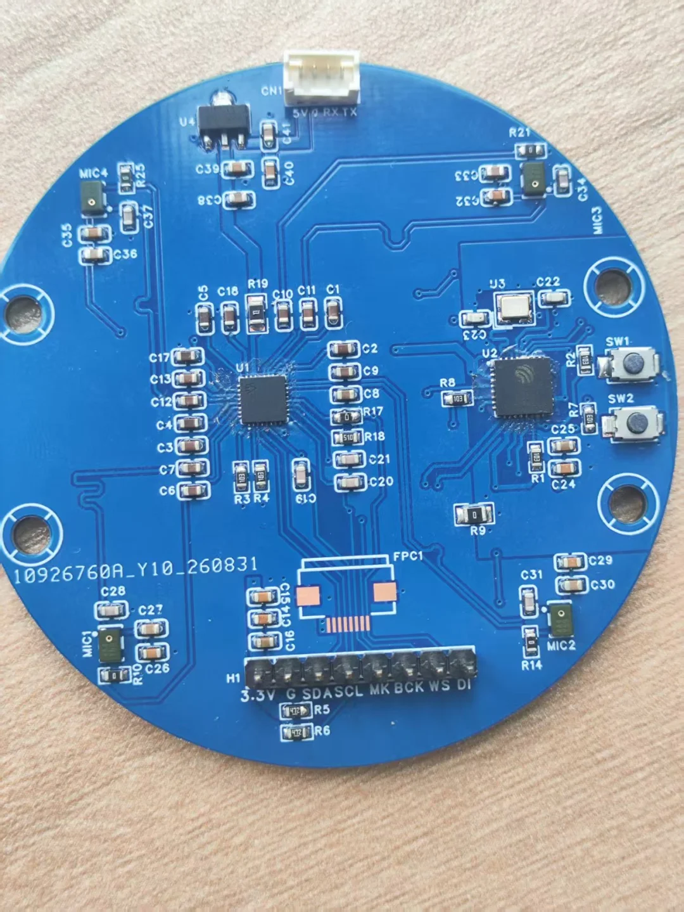

# 声源定位充电底座

| 项目 | 内容 |
| --- | --- |
| 作者 | 为欢几何（小红书号 5411270979） |
| 发布时间 | 2026-11-03 |
| 类型 | 图文 |
| 点赞 | 3 |
| 收藏 | 5 |
| 评论 | 5 |
| 分享 | 0 |
| IP 属地 | 河南 |
| 小红书原链接 | https://www.xiaohongshu.com/explore/6ae9f3ef0000000018039bd0 |

## 配图

## 正文

独立完成 360° 声源定位系统方案从零开发。通过调研选型确定 ADC 麦克风、采集芯片；学习并掌握 I2S 驱动、同步采集原理，最终选用四路 ADC 麦克风搭配 ES7210，利用 I2S+TDM 时分复用实现四路音频同步采集，将音频数据送入 ESP32‑C3，在片内完成声源定位算法计算，解析声源角度信息。原计划为期三个月的实习开发任务，因学校强制召回提前结束；项目原理图、PCB、固件程序均已完成，交接给后续实习生，经其验证，电路与程序均可正常运行。
