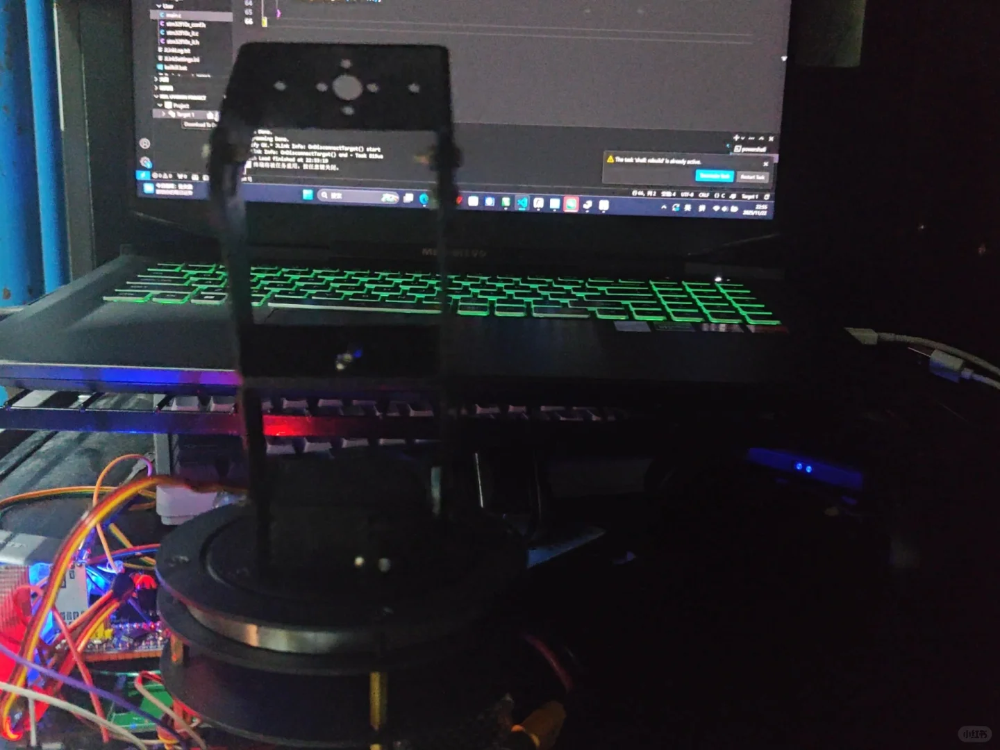

# 远程体感控制座机云台

| 项目 | 内容 |
| --- | --- |
| 作者 | 为欢几何（小红书号 5411270979） |
| 发布时间 | 2026-11-03 |
| 类型 | 视频 |
| 点赞 | 0 |
| 收藏 | 0 |
| 评论 | 0 |
| 分享 | 0 |
| IP 属地 | 河南 |
| 小红书原链接 | https://www.xiaohongshu.com/explore/6ae9eb66000000000502ef04 |

## 配图

## 视频

- [视频文件（mp4）](../images/07/video.mp4) · 时长 21 秒

## 正文

基于 STM32F103C6T6 搭建手部姿态采集系统：主控读取 JY61P 陀螺仪姿态角度，通过 HC‑12 无线模块发送角度数据；接收端同样采用 STM32F103C6T6，由 2S 航模锂电池配合 XL4005 稳压模块输出稳定 5 V，为舵机供电。调试阶段核心难点为接收数据丢包、姿态角度抖动严重；经排查定位到无线模块受周边电磁干扰，造成通信不稳定。通过调整 HC‑12 安放位置、启用 DMA 串口接收，并对角度数据引入卡尔曼滤波，有效抑制抖动，提升数据传输与姿态输出稳定性。
