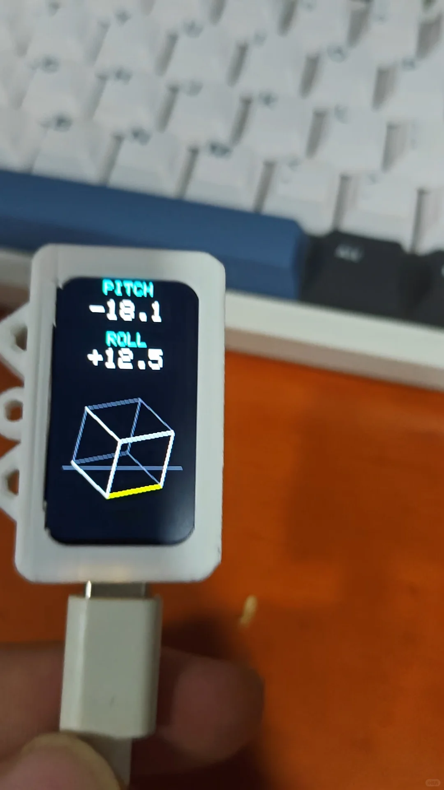

# 基于esp 32c3fh4的lvga挂件，芯片自带4 MB flash，在绘制电路的时候，没有外接flash芯片，方便布局，屏幕选择ST 7789，驱动的1.47寸LCD屏，通过读取陀螺仪角度获取挂件的运动状态，从而切换不同的界面

| 项目 | 内容 |
| --- | --- |
| 作者 | 为欢几何（小红书号 5411270979） |
| 发布时间 | 2026-11-02 |
| 类型 | 视频 |
| 点赞 | 0 |
| 收藏 | 0 |
| 评论 | 1 |
| 分享 | 0 |
| IP 属地 | 河南 |
| 小红书原链接 | https://www.xiaohongshu.com/explore/6ae8ad040000000032033e46 |

## 配图

## 视频

- [视频文件（mp4）](../images/08/video.mp4) · 时长 13 秒

## 正文

基于esp 32c3fh4的lvga挂件，芯片自带4 MB flash，在绘制电路的时候，没有外接flash芯片，方便布局，屏幕选择ST 7789，驱动的1.47寸LCD屏，通过读取陀螺仪角度获取挂件的运动状态，从而切换不同的界面
