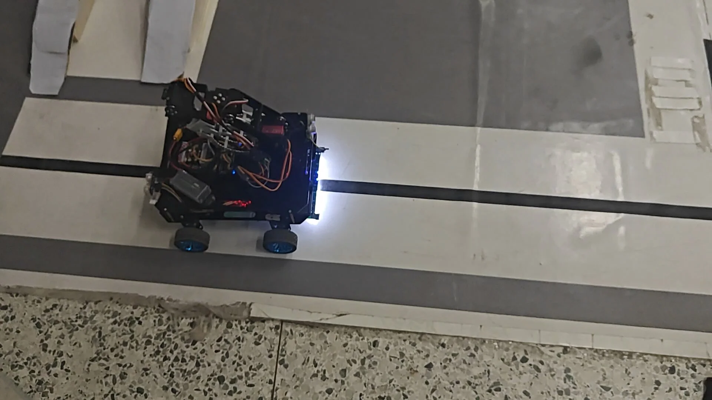

# arduino灰度传感器加陀螺仪寻迹小车，可走直线，转特定角度。

| 项目 | 内容 |
| --- | --- |
| 作者 | 为欢几何（小红书号 5411270979） |
| 发布时间 | 2025-05-22 |
| 类型 | 视频 |
| 点赞 | 5 |
| 收藏 | 3 |
| 评论 | 0 |
| 分享 | 2 |
| IP 属地 | 河南 |
| 小红书原链接 | https://www.xiaohongshu.com/explore/682eef42000000002202d9f7 |

## 配图

## 视频

- [视频文件（mp4）](../images/11/video.mp4) · 时长 32 秒

## 正文

arduino灰度传感器加陀螺仪寻迹小车，可走直线，转特定角度。
